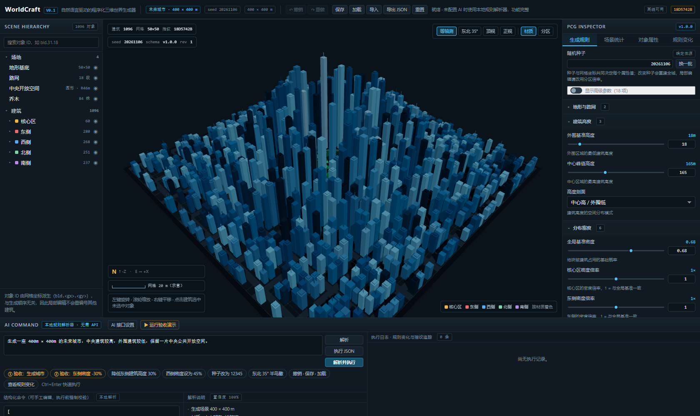
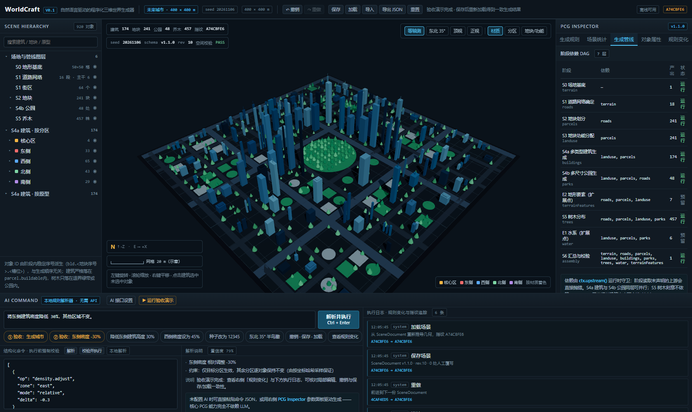
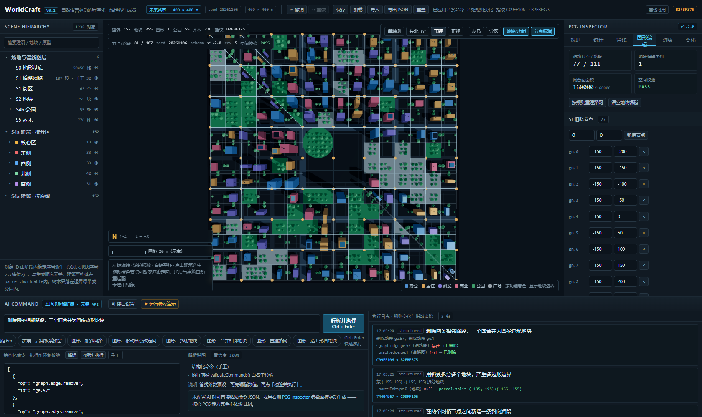
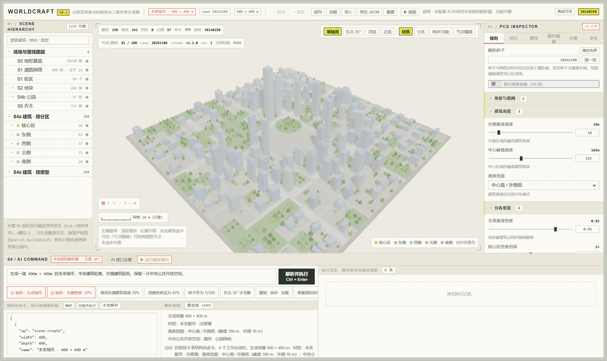
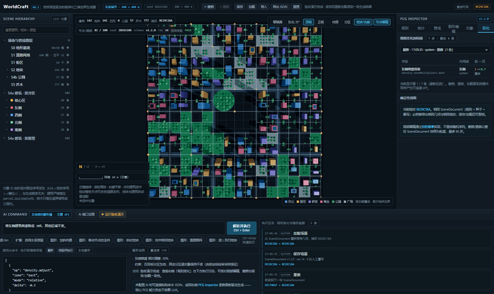
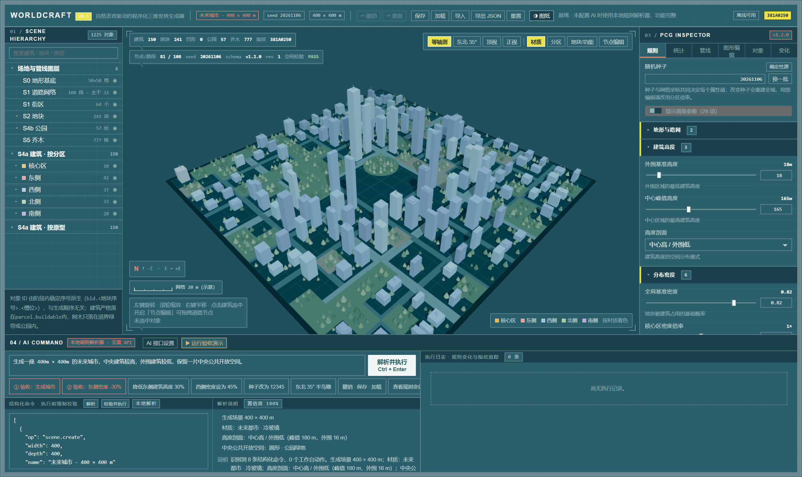

# WorldCraft — Natural Language Procedural World Builder

浏览器内运行的三维世界编辑器：用户用自然语言生成、修改、控制**程序化城市地块**场景。
首版只做城市地块，不追求任意类型三维世界。SiteLens（二维空间诊断）方案已停止，本项目为从零建立。

> 核心结论：**LLM 不生成三维代码**。自然语言只被编译成封闭的结构化命令，由受控执行器修改 SceneDocument，再由确定性分阶段 PCG 管线重新推导几何。没有 AI API 时整套核心能力可用。

**视觉体系 v1.0（制图语言）**：界面从「深色软件仪表盘」改为建筑制图语法——编号、引线注记、图例、比例尺、细线直角、图案填充、淡彩平涂三维。提供「浅色图纸 / 深色海图」双主题，顶栏 `◐ 海图 / ◑ 图纸` 切换（主题存 localStorage，不进 SceneDocument）。规范见 [VISUAL_STYLE.md](docs/VISUAL_STYLE.md)，组件级预览见 [styleboard.html](docs/styleboard.html)。
**改造只作用于呈现层**：默认场景实测仍为指纹 `381A0250`、150 建筑 / 241 地块 / 57 公园 / 777 乔木 / 空间校验 PASS，与改造前逐位一致；`npm run build` 与 93 个测试全绿。

**当前 Scene Schema：v1.2.0**（v1.0.0 / v1.1.0 存档自动迁移）。版本演进：
- v1.1.0：把扁平单函数生成流程重构为显式阶段 DAG（道路 → 地块 → 功能 → 建筑/公园 → 树木）。
- v1.2.0：**可编辑道路图 + 多边形地块系统** —— 道路节点/路段可增删改向，地块支持非矩形、多边形、凹凸边界的生成/拆分/合并/修改，编辑后建筑、公园、树木自动重适配。

---

## 1. 快速开始

```bash
cd worldcraft
npm install
npm run dev          # http://127.0.0.1:5190
```

| 命令 | 作用 |
| --- | --- |
| `npm run dev` | 开发服务器（端口 5190） |
| `npm run build` | `tsc --noEmit` + Vite 生产构建 |
| `npm run preview` | 预览 `dist/` |
| `npm test` | 12 个文件 / 93 个 Vitest 用例 |
| `npm run typecheck` | 仅类型检查 |

浏览器要求：支持 WebGL 2 的桌面浏览器（Chrome / Edge）。首次打开即加载默认 400×400 m 未来城市，无需任何配置。

**版本演进（每个阶段一张当时的画面）**

| V0.1 · 首版（1096 栋 / `18D5742B`） | v1.1.0 · 分阶段管线（`A74CBFE6`） |
| --- | --- |
|  |  |
| v1.2.0 · 可编辑几何（`B2FBF375`） | 视觉体系 v1.0 · 当前（`381A0250`） |
|  |  |

**改造前深色界面 与 当前双主题**

| 改造前工作台 | 当前海图主题 |
| --- | --- |
|  |  |

> 注：V0.1 / v1.1.0 / v1.2.0 三张为**当时留存的历史截图**（原文件由用户从回收站复原并归档）；视觉体系 v1.0 阶段当时未做浏览器截图，图纸 / 海图为后续补拍。完整分阶段配图与素材性质说明见 [DEVELOPMENT_STORY.md](docs/DEVELOPMENT_STORY.md)；组件级预览见 [styleboard.html](docs/styleboard.html)。

**一键验收演示**：点击命令面板右上角 `▶ 运行验收演示`，自动依次执行「生成城市 → 东侧密度 -30% → 撤销 → 重做 → 保存 → 加载」。

**一键图形编辑演示**：命令面板的结构化预设可依次点击「图形：加斜向路」→「图形：斜切地块」→「图形：造 L 形凹地块」，每次「校验并执行」；也可开启视口「节点编辑」直接拖拽道路节点。

---

## 2. 分阶段可编辑生成流程

```
S0 场地基底
  └─ S1 道路网络确定：可编辑 RoadGraph → 交点自动切分 → 平面闭合面提取
       └─ S2 地块划分：面细分 → 多边形地块 → 重放拆分/合并/顶点编辑
            └─ S3 地块功能分配（功能权重 / 公园聚类 / 扩展点预留）
                 ├─ S4a 多类型建筑（旋转内接矩形族，贴合斜边与凹形）  ┐ 同层可并行
                 ├─ S4b 多尺寸公园（多边形三角化，贴合地块形状）      ┘
                 ├─ E1 水系 / E2 地形要素（默认关闭的扩展点）
                      └─ S5 树木分布（多边形内净距采样）
                           └─ S6 汇总、空间无重叠校验、指纹
```

- **阶段依赖是一等公民**：`STAGE_GRAPH` 声明 deps，runner 用拓扑排序执行，`ctx.upstream()` 在运行时守卫未声明依赖。
- **可编辑图持久化**：`SceneDocument.graph` 保存节点/路段，编辑结果不会被规则参数偷偷覆盖；`graph.regenerate` 才按规则重建。
- **空间无重叠**：道路与地块共享同一条边；建筑旋转足迹 ⊂ 地块多边形；公园多边形 ⊂ 所属地块；树心受路缘/边界/株距约束。面积守恒 `Σ地块面积 = Σ闭合面面积 = 场地面积`。
- **确定性**：所有随机值仍是 `sample(seed, 属性盐, 稳定序号)`，无全局 RNG 流；相同 SceneDocument → 相同全部图层与相同指纹。
- **关键取舍**：S5 树木刻意**不依赖** buildings，因此调整建筑密度不会扰动道路、地块、功能、公园与树木。

完整规范见：
- [EDITABLE_GEOMETRY.md](docs/EDITABLE_GEOMETRY.md) — 可编辑图与多边形地块的数据结构、一致性契约、编辑命令、验证结果
- [PCG_PIPELINE.md](docs/PCG_PIPELINE.md) — 阶段依赖、参数项、空间契约
- [ARCHITECTURE.md](docs/ARCHITECTURE.md) — 整体架构与确定性证明
- [COMMAND_SPEC.md](docs/COMMAND_SPEC.md) — 命令与字段注册表
- [VISUAL_STYLE.md](docs/VISUAL_STYLE.md) — 参考图解析、Design Token、组件映射、双主题与不变量
- [ACCEPTANCE.md](docs/ACCEPTANCE.md) — 验收逐步记录

---

## 3. 首个验收场景（可复现）

1. 在 AI Command 输入：
   `生成一座 400m × 400m 的未来城市，中央建筑较高，外围建筑较低，保留一片中央公共开放空间。`
   点击「解析并执行」。
2. 继续输入：`将东侧建筑密度降低 30%，其他区域不变。` 产出单条 `density.adjust east relative -0.3`。
3. 右侧 **PCG Inspector → 变化**：显示 `density.zoneMultipliers.east 1 → 0.7`，作用域「东侧」。
4. 打开 **PCG Inspector → 管线**：查看 7 层 DAG、各阶段产出、空间校验 PASS 与扩展点契约。
5. 点「撤销 / 重做」；点「保存」后改随机种子，再点「加载」，HUD 指纹回到存档值。

实测结果（seed 20261106，Chrome / WebGL 2.0，控制台零错误）：

| 项目 | 默认场景 | 运行验收演示后 |
| --- | --- | --- |
| 建筑 | 150 | 142 |
| 道路节点 / 路段 | 81 / 108 | 81 / 108 |
| 地块 / 公园 / 乔木 | 241 / 57 / 777 | 241 / 57 / 777 |
| 空间校验 | PASS · 0 冲突 | PASS · 0 冲突 |
| 场景指纹 | `381A0250` | `BE29C1BA` |

保存/加载一致性：`savedFingerprint === BE29C1BA`，重载后 HUD 指纹一致。

### 典型图形编辑场景（浏览器实测）

| 操作 | 建筑 | 地块 | 凹形地块 | 路段 | 指纹 | 空间校验 |
| --- | --- | --- | --- | --- | --- | --- |
| 初始 | 150 | 241 | 0 | 108 | `381A0250` | PASS |
| 加斜向路段（自动切分三角地块） | 147 | 243 | 0 | 109 | `74404967` | PASS |
| 斜切多个地块 | 152 | 255 | 0 | 109 | `C09FF106` | PASS |
| 删两条相邻路段 → L 形凹地块 | 152 | 255 | **1** | 107 | `B2FBF375` | PASS |

---

## 4. 功能清单

| 需求 | 实现位置 |
| --- | --- |
| React + TS + React Three Fiber 实时三维工作台 | `src/App.tsx`、`src/components/Viewport.tsx` |
| 可编辑道路图（增删节点/路段、改走向与连通） | `src/core/geom/planar.ts`、`src/core/commands.ts` 的 `graph.*` |
| 多边形地块（生成/拆分/合并/顶点修改，含凹凸边界） | `src/core/geom/polygon.ts`、`src/core/pipeline/stages.ts` S1/S2 |
| 独立 PCG Engine（道路/地块/功能/建筑/公园/树木） | `src/core/pipeline/`、`src/core/pcg.ts` |
| 结构化 Scene Schema（规则、种子、图、编辑序列、版本、迁移） | `src/core/types.ts`、`src/core/schema.ts` |
| 自然语言 → 结构化命令，受控工具执行 | `src/core/nlp.ts`、`src/core/commands.ts`、`src/core/llm.ts` |
| 连续多轮编辑且未修改区域不变 | 按坐标哈希采样 + 互斥分区倍率 + 阶段隔离 |
| 四大面板 + 图形编辑面板 + 节点拖拽 | `src/components/` |
| 保存、加载、撤销、重做 | `src/core/store.ts`（localStorage + 文档快照，60 步） |
| 可运行 Demo、测试、技术文档 | `npm run dev`、93 测试、`docs/` |
| 双主题制图风格 UI（编号 / 注记气泡 / 图例 / 比例尺 / 淡彩三维） | `src/styles.css`、`src/components/CityScene.tsx`、`docs/VISUAL_STYLE.md`、`docs/styleboard.html` |

其它能力：对象拾取与单体覆写、任意走向的分级道路渲染、多边形公园三角化（含凹形）、旋转建筑足迹、地块边界线、规则/统计/管线/图形编辑四视图（共 6 个 Inspector 标签）、等轴/顶视/正视/东北 35° 半鸟瞰相机、命令日志与指纹追踪、规则变化时间线、JSON 导入导出、管线与图形编辑结构化预设、Ctrl+Z / Ctrl+Y / Ctrl+S 快捷键。

---

## 5. 开发约束的落实与边界

| 约束 | 落实方式 |
| --- | --- |
| 确定性 | 每个属性 = `sample(seed, 属性盐, 稳定序号)`，无全局 RNG 流；相同文档 → 相同指纹 |
| 可编辑性 | 规则参数、道路图、地块编辑序列、单体覆写四层；局部编辑只改对应分区倍率 |
| 性能 | 道路/建筑/屋顶/树干/树冠/水面/节点各 1 个 InstancedMesh；公园合并为 1 个 BufferGeometry；地块边界 1 个 LineSegments |
| 规则可追溯 | 每个建筑保留 `trace[]`（阶段、地块、多边形形状、旋转角度、逐边净距、抽样值）；文档级 diff 时间线；阶段执行记录 |
| 空间一致 | 半边面提取 + 交点自动切分 + 面积守恒 + 14 类冲突校验 |
| 预制生成模块 | 阶段固化为 `STAGE_GRAPH`，未开放自由节点图编辑 |
| 不训练模型 / 不依赖 Text-to-3D | 无任何模型推理依赖；LLM 可选且只做意图编译 |
| 后续阶段 | Blender Geometry Nodes、Unreal PCG、自由节点图编辑 **均未实现** |
| 无 AI API 可用 | 本地规则解析器 + Inspector 参数/图形编辑面板 + 可手工编辑的结构化命令 JSON |
| 视觉层与数据层隔离 | `PALETTES` 不动；淡彩化在 `CityScene.draftColor()` 渲染层完成；主题存 localStorage，不进 SceneDocument |

**已知限制（不掩饰）**

- 本地 NL 解析器是规则式，只覆盖已注册规则能表达的中文句式；无法识别时明确拒绝，不会猜测。图形编辑主要通过 Inspector 或结构化命令预设完成。
- 顶点若落在道路段上但不在图节点处，单独移动会被**拒绝**（否则地块边界会偏离道路中心线）；需先新增道路节点或改移动图节点。
- 建筑轮廓用「旋转内接矩形族」表达，不是任意多边形挤出；凹形地块会拆成多个沿臂分布的体量。
- `pipeline.parcels.inset` 只作用于公园树木净距，不对凹多边形做几何 offset（会产生越界桥接）。
- 树木净距口径为**树心到边界**，不含树冠半径。
- 连续两次 `parcel.merge` 在长边/短边端点不匹配时可能被跳过并记入 `skippedEdits`；「删两条相邻路段」是更可靠的凹形生成路径。
- LLM 为浏览器直连 OpenAI 兼容接口，密钥只存 localStorage；生产环境应改自有后端代理。
- 阴影贴图 2048²、dpr 上限 1.75；低端 GPU 可在 `Viewport.tsx` 下调。
- 制图主题为纯 CSS + WebGL 生成，未引入图片或字体资源；三维图面是淡彩平涂示意，不是参考图的手绘插画复刻。

**GPU 提示（针对本机配置）**：`Canvas` 已设置 `powerPreference: 'high-performance'` 主动请求独显。双 AOC 显示器若接在核显输出上，Chrome 可能仍走核显。可在 `chrome://gpu` 查看 "Graphics Feature Status"；必要时在 Windows「图形设置」中为 Chrome 指定「高性能 GPU」。

---

## 6. 目录

```
worldcraft/
├── src/
│   ├── core/
│   │   ├── geom/
│   │   │   ├── polygon.ts     多边形内核（面积/包含/切分/合并/自交）
│   │   │   ├── planar.ts      可编辑道路图 → 平面闭合面提取
│   │   │   └── defaultGraph.ts 初始规则网格图生成器
│   │   ├── pipeline/
│   │   │   ├── geometry.ts    AABB / 空间索引
│   │   │   ├── contracts.ts   阶段 DAG、上下文、拓扑排序、依赖守卫
│   │   │   ├── stages.ts      S0–S6 + E1/E2 全部阶段实现
│   │   │   ├── validate.ts    空间关系校验器
│   │   │   └── index.ts       执行器、GeneratedScene 汇总
│   │   ├── types.ts       Scene Schema / 图 / 编辑序列 / 图层对象 / Command / 展示色板
│   │   ├── schema.ts      默认规则、严格校验、v1.0/1.1 迁移
│   │   ├── fields.ts      规则字段注册表
│   │   ├── rng.ts         无状态哈希采样、稳定序列化、指纹
│   │   ├── pcg.ts         generateScene() 兼容入口
│   │   ├── commands.ts   命令白名单校验 + 纯函数执行器
│   │   ├── nlp.ts / llm.ts / diff.ts / store.ts / zones.ts
│   ├── components/       Viewport / CityScene / Hierarchy / Inspector / CommandPanel / TopBar
│   ├── styles.css        制图语言双主题样式（图纸 / 海图）
│   └── __tests__/        12 个测试文件、93 个用例
├── docs/
│   ├── EDITABLE_GEOMETRY.md 可编辑图与多边形地块规范、验证结果
│   ├── PCG_PIPELINE.md      阶段依赖、数据结构、参数项、空间契约
│   ├── ARCHITECTURE.md      架构与确定性证明
│   ├── COMMAND_SPEC.md      命令、字段注册表、NL 与 LLM 契约
│   ├── VISUAL_STYLE.md      参考图解析 / Design Token / 组件映射 / 不变量
│   ├── DEVELOPMENT_STORY.md 分阶段开发过程记录（视频讲述用，含各阶段配图）
│   ├── styleboard.html      双主题组件级视觉风格板（单文件，可直接打开）
│   ├── ACCEPTANCE.md        验收逐步记录
│   └── screenshots/         分阶段历史截图 + 当前版本实拍（见 DEVELOPMENT_STORY.md）
└── README.md
```

---

## 7. 后续阶段建议（按优先级）

1. **自由节点图编辑**：把阶段改成可插拔模块描述，为 Blender Geometry Nodes / Unreal PCG 数据模型对齐做准备。
2. **实现 E1 水系 / E2 地形要素**：按已声明 contract 补齐水面多边形、岸线退界、高程场回填与道路纵断协调。
3. **多边形布尔运算升级**：用 Greiner–Hormann 或 Clipper 替代当前的共边消除合并，支持任意相邻/重叠地块合并。
4. **分区谓词可配置**：把五分区轴主导互斥升级为「区域选择器 + 规则叠加层」，保留不变量测试。
5. **LOD / 分块生成**：场地扩大到 2 km × 2 km 时按街区分块生成与裁剪。
6. **LLM 后端代理**与结构化输出（tool calling / JSON Schema）替代浏览器直连。
