# WorldCraft 开发过程记录（视频讲述用）

> **依据**：项目现有 `README.md`、`docs/` 内六份规范与验收文档、Git 提交记录、以及开发时留存的工作区记录。
> **口径**：只记录已经发生的需求、改动、问题、处理结果和实测数据；各阶段数字标注所属版本，跨阶段数字不混用；未验证的内容明确写「未做」。
> **用法**：按阶段顺序讲述即可。每阶段包含「定位 / 需求 / 关键功能与取舍 / 改动范围 / 问题与处理 / 已有验证 / 可取的演示点 / 配图 / 衔接提示」；最后一节是可直接挑选的演示亮点清单与配图速查。

---

## 0. 开场：用一页讲清这个项目

**项目目标（最初的需求口径）**：做一个在浏览器里运行的三维世界编辑器，用户用自然语言生成、修改、控制程序化三维场景；首版只支持程序化城市地块，不追求任意类型的三维世界。开发约束是优先保证 PCG 生成的确定性、可编辑性、性能和规则可追溯性；首版只用开发者预制的程序化生成模块；不训练三维生成模型、不依赖一次性 Text-to-3D；即使没有配置 AI API，也要能通过结构化命令和参数面板测试核心能力。

**贯穿全程的那把尺子**：验收场景要求先「生成一座 400m × 400m 的未来城市，中央建筑较高，外围建筑较低，保留一片中央公共开放空间」，再「将东侧建筑密度降低 30%，其他区域不变」，并且要能查看规则变化、撤销、保存后重载得到一致结果。「其他区域不变」这五个字决定了整个项目的架构走向。

**时间线总览**

| 阶段 | 版本 | 核心命题 | 当时的验证锚点 |
| --- | --- | --- | --- |
| 一 | V0.1 | 先让「其他区域不变」在架构上成立 | 39 用例；1096 → 1021 栋；指纹 `18D5742B → 42A85A40` |
| 二 | v1.1.0 | 把散落的生成逻辑拆成可配置、可追溯的阶段 DAG | 77 用例；180 建筑 / 241 地块 / 48 公园 / 457 乔木；指纹 `6306E0CA`；14 组参数组合全 PASS |
| 三 | v1.2.0 | 道路图可编辑 + 多边形、凹凸地块的自动重适配 | 93 用例；64 个闭合面面积和精确等于 160000 m²；典型编辑四步全 PASS |
| 四 | 视觉体系 v1.0 | 换成建筑制图语法，但不触碰已验收的数据层 | 指纹 `381A0250` 与改造前逐位一致；93 用例全绿 |
| 五 | 交付 | 新建 GitHub 仓库，保留已有旧库 | 4 提交 / 57 文件 / 远端 HEAD 与本地一致 |

### 配图说明（先看这一段，避免讲错版本）

**V0.1 / v1.1.0 / v1.2.0 三个版本都有当时留下的真实界面截图。** 原文件一度被删除，后由用户从回收站复原，现已复制归档到 `docs/screenshots/history-*`（原文件保留在工作区根目录，未改动）。加上整理本记录时补拍的当前版本画面，共三类素材：

| 类别 | 数量 | 文件 | 记录内容 |
| --- | --- | --- | --- |
| 历史存档 · V0.1 | 3 张 | `history-v01-*` | 首版深色界面，HUD 为 1096 / 1021 栋、指纹 `18D5742B` / `42A85A40`、schema v1.0.0 |
| 历史存档 · v1.1.0 | 5 张 | `history-v11-*` | 分阶段管线版本，HUD 为 174 建筑 / 241 地块 / 48 公园 / 457 乔木、指纹 `A74CBFE6`；另有参数调整后的 `5E4CEAB5` 与命令面板布局修复前后的局部对照 |
| 历史存档 · v1.2.0 | 2 张 | `demo-workbench.png`、`demo-editable-top.png` | 可编辑几何版深色界面；`demo-topview.png` 是后者的副本。复原出的 `wc3-*.png` 与这两张哈希一致，无新增内容 |
| 当前版本实拍 | 7 张 | `story-01` … `story-07` | 2026-11-06 补拍，界面为制图语言 v1.0；Chrome / WebGL 2.0，控制台零错误 |
| 仓库页实拍 | 1 张 | `story-08-github.png` | `chovy7519/worldcraft-hy4` 公开仓库首页 |

**唯一没有历史界面截图的是视觉体系 v1.0 阶段**：该阶段当时未做浏览器截图验证，现有图纸 / 海图画面是后续整理记录时补拍的，已在阶段四明确标注。其余阶段以历史截图为主，当前版本画面只作为「同一场景在新界面下」的对照，不冒充历史。

**两组可直接引用的硬证据**：V0.1 历史截图的 HUD 与阶段一实测数字逐项吻合（`18D5742B → 42A85A40`、1096 → 1021）；v1.1.0 历史截图显示 7 层 DAG 与 `A74CBFE6`、参数调整后 `5E4CEAB5`。补拍的默认场景四张同为 `381A0250`，图形编辑终态 `story-05` 为 `B2FBF375` / 255 地块 / 凹形 1，与 v1.2.0 历史实测一致 —— 视觉改造没有侵入数据层。

**开场衔接提示**：「这不是一个从界面开始做的项目。第一版连颜色都没定，先解决的是一个听起来很小的要求——改东边，别动西边。」

---

## 阶段一 · V0.1：先钉死确定性，再谈三维

**一句话定位**：从零建立工作台，把所有架构决策押在「局部编辑不得扰动其他区域」这一条上。

### 需求

停止此前的 SiteLens（二维空间诊断）方案；工作区原本是空目录，无遗留代码，WorldCraft 完全从零建立。需要 R3F 实时三维工作台、独立 PCG Engine、结构化 Scene Schema、自然语言到受控命令的转换、连续多轮编辑、四大面板、保存/加载/撤销/重做，以及 Demo、测试和技术文档。

### 关键功能与设计取舍

- **放弃全局 RNG 流**。若用 `mulberry32(seed)` 顺序抽样，东侧被接受的地块变少会改变后续随机调用次数，全城高度、颜色、布局整体错位。改为按「种子 + 属性盐 + 网格坐标」独立哈希的无状态采样，每个属性各自取值；对象 ID 由网格坐标派生。这是整个项目最关键的一次判断。
- **分区采用轴主导五分区互斥**（core / east / west / north / south），避免叠加谓词在东北角产生归属歧义，才能让「非东侧逐位不变」被逐对象断言。
- **几何不落盘**：`SceneDocument` 只存规则、种子、人工覆写，几何由纯函数 `generateScene(doc)` 派生；指纹用于保存/加载一致性校验。
- **LLM 不生成三维代码**：自然语言只编译成封闭的 `Command[]` JSON，经白名单校验后由受控执行器运行。字段注册表（当时 34 项）是单一事实来源，同时驱动 Inspector 控件、命令校验和 LLM 工具目录。
- **撤销/重做用整份文档快照**（60 步），避免相对调整反向推导的浮点误差。
- **渲染用 InstancedMesh**：约 1000 栋建筑压到约 2 个建筑 draw call，并显式请求高性能 GPU。

### 主要改动范围

React + TypeScript + Vite + React Three Fiber 工程骨架、`core/` 下的类型与规则/哈希/分区/管线入口/命令/NL/LLM/store、四大面板组件、四份技术文档与两张演示截图。

### 遇到的问题 → 最终处理结果

| 问题 | 处理结果 |
| --- | --- |
| 全局 RNG 流会让局部编辑导致全城重建 | 改为按坐标与属性盐独立哈希；由单元测试逐对象断言，不靠目视 |
| 撤销 / 加载后「规则变化」面板变空，不满足「可查看规则变化」 | 新增文档级 diff，改成可回溯的规则变化时间线，撤销、重做、加载也产生 diff |
| 浏览器实测发现底部命令编辑器被面板高度裁切；主按钮内换行文字在 flex 下横向溢出；中央开放空间被路网压暗；favicon 404 | 调整栅格行高与按钮纵向布局；抬高开放空间图层并调整配色；内联 favicon |
| 本机双屏可能接在核显输出上，独显未参与渲染 | 显式设置 `powerPreference: 'high-performance'`，并在文档写明 `chrome://gpu` 排查项 |
| 无 AI API 时核心能力不可用 | 本地中文规则解析器 + 手工结构化 JSON + 参数面板三条路径，全部走同一执行器 |

### 已有验证结论

- `tsc --noEmit` 通过、39 个用例全绿、`vite build` 通过。
- 浏览器（Chrome / WebGL 2.0，控制台零错误）：生成 1096 栋 / 指纹 `18D5742B`；东侧密度 -30% 后 1021 栋 / `42A85A40`；东侧占用率 52%，其他分区 65–70% 逐位不变。
- 撤销 → 重做 → 保存 → 改种子 → 加载：存档指纹与重载后 HUD 指纹一致。
- 顶视确认中央圆形公园、乔木与规则路网正常渲染。
- 复原归档的 V0.1 原始截图（`history-v01-*`）HUD 与上述数字逐项吻合：初始 `18D5742B` / 1096 栋，演示后 `42A85A40` / 1021 栋，顶视可见中央圆形公园。

### 视频可取的演示点

- 用一张「全局随机流 vs 坐标哈希」的对比图讲清架构判断，不需要操作界面。
- 一键验收演示的六步流程，以及 HUD 上前后两个指纹值。
- 规则变化时间线里 `density.zoneMultipliers.east 1 → 0.7` 这一条，配合分区统计表看「只有东侧变了」。

### 配图

V0.1 的三张原始界面截图已复原，HUD 数字与本节「已有验证结论」逐项吻合：

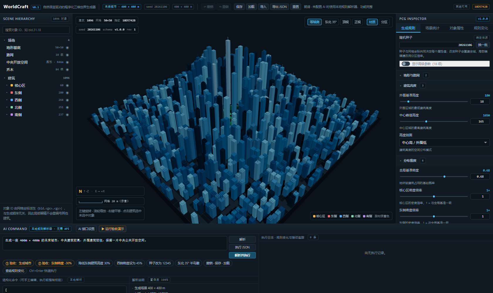

*首版深色工作台：1096 栋蓝色玻璃建筑、中心高外围低，HUD 指纹 `18D5742B`、schema v1.0.0、rev 1。*

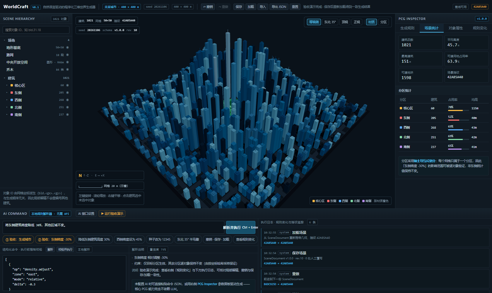

*东侧密度 -30% 之后：1021 栋、指纹 `42A85A40`、rev 10；右侧分区统计直接显示东侧与其他分区的占用率差异，底部执行日志 6 条。*

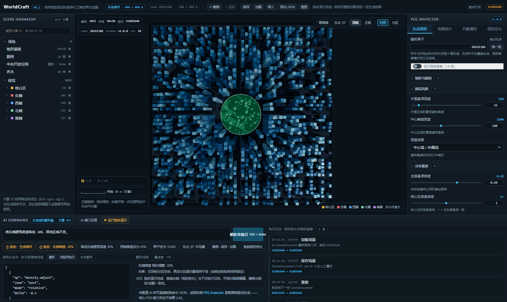

*顶视确认中央圆形公园绿地与规则路网，指纹同为 `42A85A40`。*

当前版本复现（可选对照）：`screenshots/story-02-acceptance-diff.png` 是同一条验收链路在制图语言界面下的画面，指纹 `BE29C1BA`，**不是 V0.1 界面**。

> 录制建议：先讲「为什么全局 RNG 流不行」，再用前两张历史图看指纹从 `18D5742B` 变到 `42A85A40`，最后用顶视图收在中央开放空间。

> **衔接提示**：「到这里，验收场景跑通了。但生成逻辑还是一整块——道路只是按行列排除格子，公园只有一个中央圆，树是在圆里随机撒点。下一步要让它变成能被检查、能被调参的流程。」

---

## 阶段二 · v1.1.0：把生成逻辑拆成阶段 DAG

**一句话定位**：补齐道路、公园、树木的 PCG 设计，纳入统一可配置流程，并让空间关系可校验。

### 需求

按依赖阶段组织：道路网络确定 → 地块划分 → 功能分配 → 多种建筑类型生成 → 多种尺寸公园地块生成 → 与道路和地块边界协调的树木分布；为后续水系与地形元素预留扩展点。要求阶段依赖清晰、空间布局无重叠、参数可调、相同输入结果一致；交付可运行实现、关键数据结构与参数项、阶段依赖定义，以及覆盖整条链路的验证结果。

### 关键功能与设计取舍

- **显式阶段 DAG**：`STAGE_GRAPH` 声明依赖，runner 拓扑排序执行，`ctx.upstream()` 在运行时守卫未声明依赖。S4a 建筑与 S4b 公园同层可并行，E1 水系 / E2 地形作为默认关闭的扩展点。
- **地块实体化**：从「网格排除道路」升级为带红线、退界、面积、分区、临路面信息的 `ParcelObject`；建筑严格落在可建范围内。
- **空间契约**：分级道路（主干 / 支路）、中央公园内部道路抑制、矩形公园聚类（L 形聚类会拆散）、三档公园尺寸、五种建筑原型；行道树落在退界绿带内，园树按边界净距布点，并统一过滤路缘净距、边界净距、最小株距与可建范围。
- **S5 树木刻意不依赖 buildings**：调整建筑密度不会扰动道路、地块、功能、公园与树木，把局部编辑不变量从「建筑」扩展到整条链路。
- **参数全部注册到字段表**：Inspector 控件、命令校验、LLM 工具目录仍由同一注册表驱动。

### 主要改动范围

新增 `src/core/pipeline/`（几何工具、阶段契约、阶段实现、校验器、执行器）与 `src/core/diff.ts`；`types.ts` 增加管线参数、地块/公园/道路/树木数据结构；Scene Schema 升 v1.1.0 并支持旧存档迁移；Inspector 增加「生成管线」视图与统计；命令面板增加管线参数预设；新增 `docs/PCG_PIPELINE.md`，更新其余文档。测试从 39 增至 77 用例。

### 遇到的问题 → 最终处理结果

| 问题 | 处理结果 |
| --- | --- |
| 汇总阶段读取 `terrain`、`terrainFeatures` 读取 `landuse` 却未声明依赖 | 运行时依赖守卫直接报错，补齐声明；把依赖做成运行时约束而非文档约定 |
| 退界 / 间距 / 原型退台被重复叠加，绝大多数建筑槽位尺寸为负被静默丢弃（东侧只剩 6 栋） | 修正尺度链，而不是放宽测试 |
| 场地边缘两条道路带越界 1.5 m | 道路带裁剪到场地 AABB |
| 公园全部落在「口袋」档、中心区未形成塔楼梯度、扩展点关闭时预留地块统计丢失 | 调整尺寸分档阈值与核心区塔楼权重；扩展阶段改为始终运行，关闭时输出空层但保留统计 |
| L 形公园聚类的外接矩形罩住同街区未被划入公园的可建地块，公园树落进建筑基底 | 约束聚类必须为矩形，并在树木阶段加「不落在可建地块内」的硬过滤 |
| 相邻地块共顶点被射线法误判为公园侵入 | 改用严格的多边形重叠判定 |
| 首版道路只是「排除格子」、公园只有一个中央圆、树与边界无协调关系 | 引入地块实体、分级路网、多尺寸公园与净距驱动的树木分布 |

### 已有验证结论

- 11 文件 / 77 用例全绿；`tsc --noEmit` 与 `vite build` 通过。
- 默认场景（seed `20261106`）：18 条道路带 / 16 段有效、总长 6400 m；64 街区 / 241 地块；180 栋建筑（五种原型）；48 处公园（三档）；457 株乔木；指纹 `6306E0CA`；空间校验 PASS、0 冲突；最小株距 3.52 m（要求 ≥3.5）、最小路缘净距 2 m（要求 ≥2）。
- 14 组参数组合全部 PASS；校验器能主动发现人为注入的冲突。
- 浏览器实测：验收演示六步后建筑 180 → 174、指纹 `6306E0CA → A74CBFE6`；保存/加载 `match: true`；把 `parkRatio` 调到 0.2，建筑 174 → 145、公园 48 → 63、树 457 → 480、指纹 `5E4CEAB5`，空间校验仍 PASS；控制台零错误。
- 复原归档的 v1.1.0 原始截图（`history-v11-*`）与上述数字吻合：`A74CBFE6` 的 7 层 DAG 与分区统计、`5E4CEAB5` 的参数调整结果，以及命令面板布局修复前后的局部对照。

### 视频可取的演示点

- 「生成管线」面板的 7 层 DAG、各阶段产出与依赖、E1/E2 的「预留」标记。
- 改一个管线参数，看指纹和多个图层统计同时变化——说明参数确实接到了阶段上。
- 「地块/功能」顶视：规则路网、地块边界线、按功能着色的建筑、中央大公园与多处分散小公园。

### 配图

v1.1.0 的三张主界面截图已复原，正好对应「依赖关系 / 空间结果 / 参数敏感性」三件事：

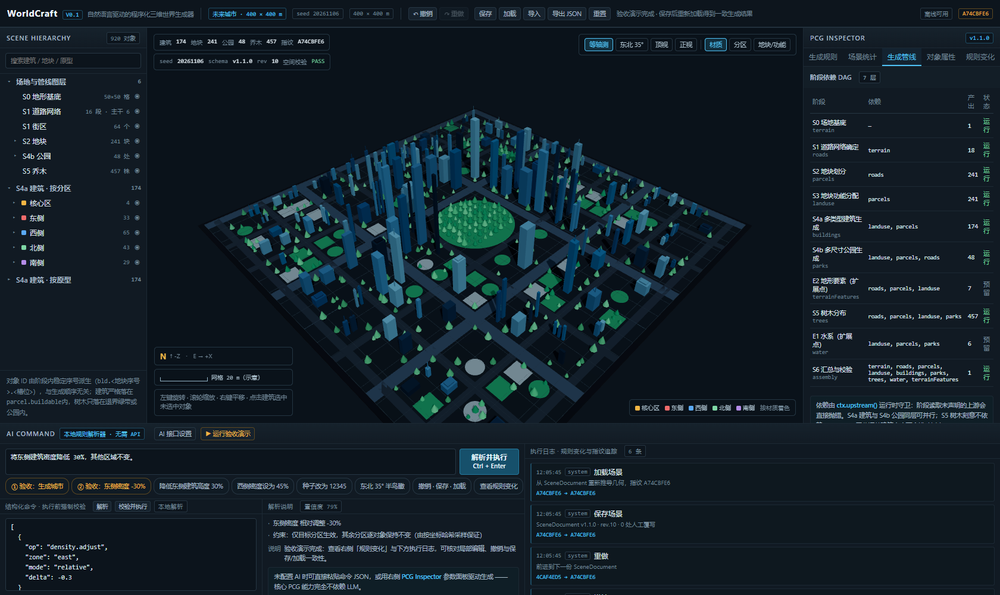

*右侧「规则依赖 DAG · 7 阶」完整列出 S0–S6 与 E1/E2 及其产出；HUD 为 174 建筑 / 241 地块 / 48 公园 / 457 乔木、指纹 `A74CBFE6`、schema v1.1.0、空间校验 PASS。*

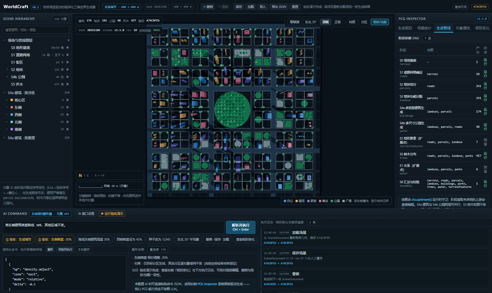

*功能着色、地块边界线、中央圆形公园与多处不同尺寸的分散公园。*

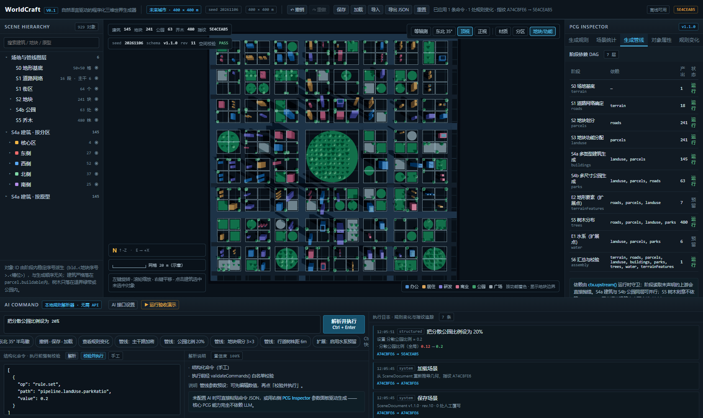

*把 `parkRatio` 调到 0.2 后：145 建筑 / 63 公园 / 480 乔木、指纹 `5E4CEAB5`，右侧 DAG 的 S4a / S4b / S5 产出同步变化。*

**UI 细节修复的前后对照**（对应阶段一问题表中「命令面板被裁切、主按钮文字横向溢出」那条，截图摄于 v1.1.0 界面）：

| 修复前 | 修复后 |
| --- | --- |
| 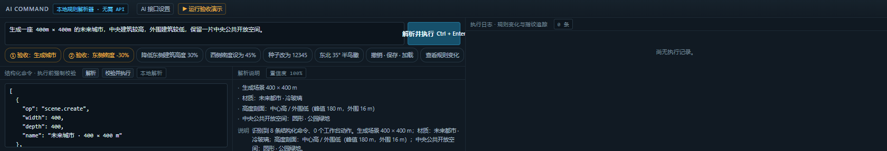 | 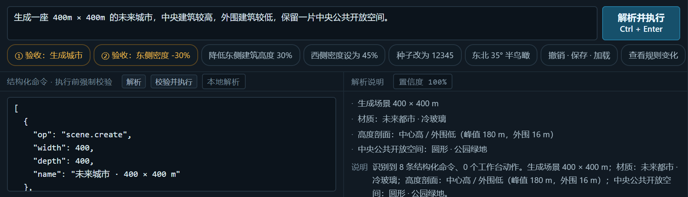 |

*左图主按钮文字横向溢出、下方内容被裁切；右图为调整栅格高度与按钮纵向布局后的局部画面。*

当前版本复现（可选对照）：`story-03-pipeline-dag.png`、`story-04-parcel-top.png` 是同一场景在制图语言界面下的画面，指纹 `381A0250`。

> **衔接提示**：「现在流程是可追溯了，但路网还是规则正交、地块还是矩形。用户真正想编辑的是形状本身——于是必须把『地块』重新定义一次。」

---

## 阶段三 · v1.2.0：可编辑道路图与多边形地块

**一句话定位**：把「规则网格 + 矩形地块」重构成平面图系统，让形状变化后下游自动重适配。

### 需求

支持增删道路节点与路段、调整走向和连通关系；支持生成、拆分、合并及修改非矩形、多边形、凹凸边界地块；保持道路与地块边界闭合、无重叠且关系一致。编辑后建筑、公园、树木自动重新适配复杂地块形状，避免越界、穿插和不合理空隙；多次编辑后仍保持一致、可运行，并验证典型编辑场景。

### 关键功能与设计取舍

- **关键判断**：地块不再是「网格里排除道路后的矩形」，而是**道路图围合出的平面有界面**。斜向连路让相邻地块自然变梯形/三角形，删两条相邻边让三个面合并成 L 形凹多边形；道路与地块共享同一对节点，闭合性来自拓扑而不是事后修补。代价是必须真正实现平面面提取与多边形布尔内核。
- **几何内核**：`geom/polygon.ts`（面积、点包含、逐边距离、半平面裁剪、最长内部弦切分、共边合并、自交检测）、`geom/planar.ts`（交叉点自动切分 + 半边环遍历提取闭合面）、`geom/defaultGraph.ts`（初始网格图）。
- **可编辑状态持久化**：`SceneDocument.graph` 保存节点/路段，`parcelEdits` 保存空间操作序列（split / merge / vertex）；Schema 升 v1.2.0，v1.0 / v1.1 存档自动迁移。命令层新增 `graph.*` 与 `parcel.*`，全部经白名单校验。
- **下游重适配**：建筑用「旋转内接矩形族 + 逐边净距」贴合斜边与凹形；公园用多边形并集三角化；树在多边形内按净距采样；S6 做 14 类空间冲突校验。
- **一致性策略**：顶点匹配道路图节点时同步移动节点（道路与地块边界一起变）；落在道路段上但不匹配节点的孤立顶点移动被**明确拒绝**——否则地块边界偏离道路中心线、建筑随即压占道路带。改场地尺寸时按比例缩放全部图节点以保面积守恒。

### 主要改动范围

新增 `src/core/geom/` 三个文件；`types.ts` / `schema.ts` / `commands.ts` 扩展图与编辑序列；`pipeline/stages.ts` 的 S1/S2/S4a/S4b/S5 全部重写；`pipeline/validate.ts` 换成多边形空间校验；`CityScene.tsx` 支持任意走向道路、多边形公园、地块边界线与节点手柄；Inspector 增加「图形编辑」标签，Viewport 增加「节点编辑」与「地块/功能」视图；命令面板增加 6 个图形编辑结构化预设；新增 `docs/EDITABLE_GEOMETRY.md`，更新其余文档与截图。测试增至 12 文件 / 93 用例。

### 遇到的问题 → 最终处理结果

| 问题 | 处理结果 |
| --- | --- |
| 公园几何内缩在凹多边形上产生越界桥接 | 取消凹多边形 offset，公园范围直接取地块多边形并集；`inset` 只用于公园树木净距 |
| 建筑体量相对新地块过大；候选中心网格步长恰好跳过唯一可行点，导致零建筑 | 改为「质心 + 加密网格」采样，体量按目标地块尺度，退界从统一值改成逐边净距（临主干 6 m / 支路 4 m / 内部 3 m） |
| 切割线起点落在地块内部时只得到 1 个交点，拆分操作全部被拒绝 | `clipSegmentInside` 纳入 0/1 端点并合并连续内部区间，得到两端都落在边界上的最长弦 |
| `splitByChord` 在 B 恰好落在已有顶点时仍平移索引，链重建越界 | 只在真正插入顶点时平移索引，并加防御 |
| `mergePolygons` 在长边与短边端点不匹配时失败，凹多边形生成不出来 | 增加边界顶点对齐；并实测确认「删除两条共享节点的相邻路段」是更可靠的凹形生成路径，做成一键预设 |
| 公园与可建地块共顶点被射线法误报；孤立节点被判为错误 | 改用严格重叠判定；孤立节点降级为统计项 |
| 单独移动道路交叉点处的地块顶点，导致建筑压占道路带 | 区分两类顶点：匹配图节点则同步移动节点，路段上的孤立顶点移动被拒绝 |
| 改场地尺寸时持久化图节点不缩放；管线耗时从 2.5 s 涨到 37 s；8 个旧测试基于矩形地块断言失败 | 按比例缩放图节点；优化采样；更新旧断言以适配新空间模型（不是放宽校验） |
| 47 / 167 个可建地块为空 | 默认 `density.base` 从 0.68 提到 0.82——属于密度参数调整，不是几何修复 |
| 连续两次 `parcel.merge` 可能被跳过 | 记入 `skippedEdits` 明示，并在文档中说明更可靠的替代路径 |

### 已有验证结论

- 12 文件 / 93 用例全绿；`tsc --noEmit`、`vite build` 通过；浏览器 Chrome / WebGL 2.0 零控制台错误。
- 初始网格图提取 **64 个闭合简单面，面积和精确等于 160000 m² = 场地面积**；`editable.test.ts` 含连续 12 步编辑逐步校验，每步断言面积守恒、`spatial.ok`、建筑 ⊂ 地块、树心 ⊂ owner 且不在建筑内、公园 ⊂ 所属地块。
- 典型编辑实测（每步空间校验 PASS）：

| 操作 | 建筑 | 地块 | 凹形 | 路段 | 指纹 |
| --- | --- | --- | --- | --- | --- |
| 初始 | 150 | 241 | 0 | 108 | `381A0250` |
| 加斜向路段 | 147 | 243 | 0 | 109 | `74404967` |
| 斜切多个地块 | 152 | 255 | 0 | 109 | `C09FF106` |
| 删两条相邻路段 → L 形凹地块 | 152 | 255 | **1** | 107 | `B2FBF375` |

- 验收演示后 142 建筑 / 指纹 `BE29C1BA`；保存后改种子再加载，`match: true`，`graph`（77 节点）与 `parcelEdits` 完整往返。
- 已知边界写进文档：本地 NL 解析器是规则式；建筑轮廓是旋转内接矩形族而非任意多边形挤出；`parcel.vertex` 在路段上的孤立顶点被拒；E1/E2 仍为占位；树冠半径未参与净距判定。

### 视频可取的演示点

- 图形编辑三连：斜向路 → 斜切地块 → L 形凹地块，每一步的 HUD 数字与「空间校验 PASS」同框。
- 顶视「地块/功能」视图叠加橙色节点手柄、青色地块红线，直接看形状从矩形变成梯形、再出现凹角。
- 「图形编辑」面板里的编辑序列与闭合面面积 160000/160000，讲「关系一致」不是靠视觉检查。
- 讲一个被抓到的真实 bug：顶点编辑曾让建筑压占道路带，于是系统选择拒绝这类操作。这类「主动说边界」的内容比全绿截图更有说服力。

### 配图

这一阶段同样留有真实历史截图（复原的 `wc3-*.png` 与现有 `demo-*` 存档哈希一致），并有当前版本复现，适合直接做前后对照：

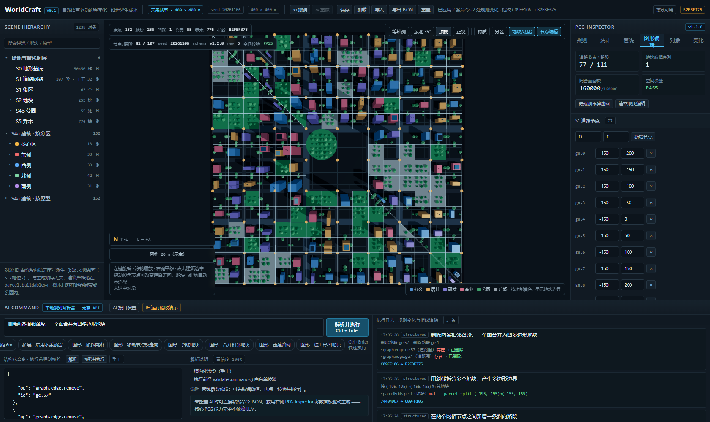

*历史存档：橙色节点手柄、地块边界、斜向路与 L 形凹地块，右侧为图形编辑面板，HUD 显示凹形 1。*

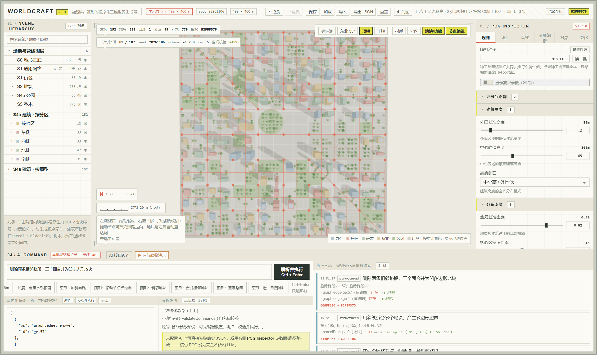

*当前版本（淡彩图纸主题）复现「加斜向路 → 斜切地块 → 造 L 形凹地块」：HUD 为 152 建筑 / 255 地块 / 凹形 1 / 指纹 `B2FBF375` / 空间校验 PASS，与阶段三记录的实测值一致。*

> 两张图形状与指纹一致、只有表达语言不同，是讲「视觉层与数据层隔离」最直观的一组对照。

> **衔接提示**：「到这里，功能其实已经完整了。但界面还是深色软件仪表盘的样子——而参考图是建筑制图。最后的挑战是：换一套表达语言，却不能让前面所有指纹失效。」

---

## 阶段四 · 视觉体系 v1.0：制图语言改造

**一句话定位**：把界面从「软件仪表盘语言」翻译成「图纸语言」，同时把数据层完全隔离在外。

### 需求

用户提供 5 张建筑 / 游戏制图参考图，指出现有深色 UI 不符合其风格。

### 关键功能与设计取舍

- **解析结论**：参考图的共性不是配色，而是**制图表达语法**——编号、引线注记、图例、比例尺、细线直角、图案填充、平涂淡彩、正投影 / 等距。五张图分属「深底白线海图」与「浅底墨线图纸」两套明暗，因此做**双主题**（图纸 / 海图），而不是取其一。
- **双层策略**：参考图是「成果图面」不是「操作界面」，直接照搬会损失拾取性和状态可辨性。外壳（顶栏 / 层级 / 检查器 / 命令面板）借制图语法但保留功能性对比；视口完整采用淡彩制图配色作为「图面」存在。
- **不插画化**：图案填充只用 CSS 渐变生成 45° 斜线与方格，不引入图片、字体或第三方 UI 库。
- **视觉层与数据层严格隔离（最关键的一条）**：`PALETTES` 中的 `b.color` 计入场景指纹，改动会让 README 与验收文档里全部指纹失效。因此只调整两个纯展示常量 `ZONE_COLORS` / `LAND_USE_COLORS`；材质淡彩化在 `CityScene.draftColor()` 渲染层做 HSL 重映射；不改任何几何或规则参数，主题存 localStorage、不进 `SceneDocument`。

### 主要改动范围

`src/styles.css` 全量重写（+376 / −148，双 CSS 变量主题、方格纸纹、四角角标、注记气泡引线、编号伪元素、直角细线控件）；`core/types.ts` 仅改两个展示色板常量；`CityScene.tsx` 增加 `SheetTheme` / `THEME` / `draftColor()`，纸底淡彩、去强自发光；`App` / `TopBar` / `Viewport` 增加主题切换；`index.html` favicon 同步；新增 `docs/VISUAL_STYLE.md`（逐图解析、差距对比、Design Token、组件映射、三维色表、不变量）与 `docs/styleboard.html`（单文件双主题风格板，含纯 SVG 等距城市图面）；README 更新。

### 遇到的问题 → 最终处理结果

| 问题 | 处理结果 |
| --- | --- |
| 直接照搬成果图面会损失可用性（背景褪色、字号过小、无焦点态） | 双层策略：外壳保留功能对比，视口完整淡彩，两者用 1px 墨线分隔、不用阴影 |
| 改色板会让全部已验收指纹与文档数据失效 | 只在渲染层做 HSL 重映射；实测默认场景指纹与改造前逐位一致 |
| 五张图分属两套明暗主题，单主题会丢掉 1/5 的参考信息 | 提供「图纸 / 海图」双主题，主题存 localStorage |
| **当时**未做浏览器截图验证（playwright-cli 未安装、5190 端口有遗留 server） | 当时如实记为未覆盖，README 把旧截图标注为「改造前界面」；**后续整理本记录时补拍了当前版本的界面截图**（`story-01` / `06` / `07`），性质是补拍，不是当时的验证记录 |

### 已有验证结论

- `tsc --noEmit`、`vite build` 通过；12 文件 / 93 用例全绿。
- 默认场景实测仍为指纹 `381A0250`、150 建筑 / 241 地块 / 57 公园 / 777 乔木、空间校验 PASS，**与改造前逐位一致**；`styleboard.html` 内嵌 JS `node --check` 通过；dev server 确认新 CSS 已生效。
- 补拍截图时（2026-11-06）Chrome / WebGL 2.0 控制台零错误，四张默认场景图的 HUD 均为 `381A0250`。
- 明确边界：三维图面是淡彩平涂示意，不是参考图的手绘插画复刻；视觉资源全部由 CSS / WebGL 生成。

### 视频可取的演示点

- 顶栏一键切换「图纸 / 海图」，同一份场景、同一个指纹，两种表达。
- `docs/styleboard.html` 与参考图的语法对照：编号、引线、图例、比例尺如何落到控件上。
- 把「视觉改造前后指纹都是 `381A0250`」当作这一段的高潮：证明风格层没有侵入已验收的数据层。

### 配图

三张全部是视觉体系 v1.0 落地后的真实画面：

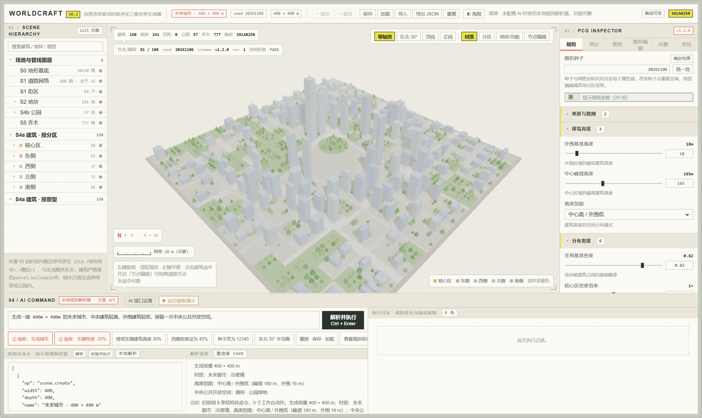

*浅色图纸主题，编号标题、注记气泡、图例、比例尺与细线直角；HUD 指纹 `381A0250`。*

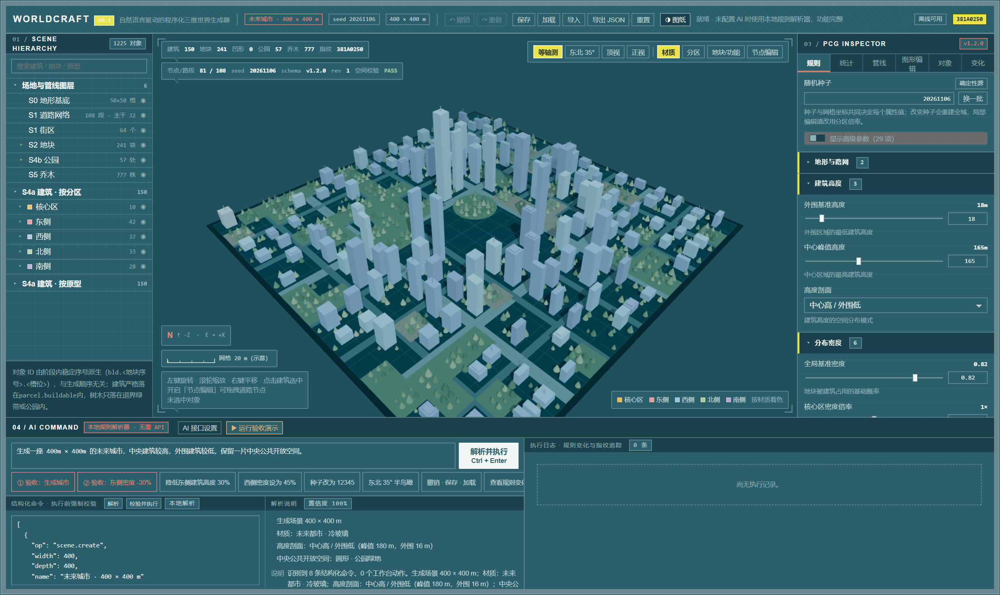

*深色海图主题，同一份场景、同一指纹 `381A0250`；与上一张构成双主题对照。*

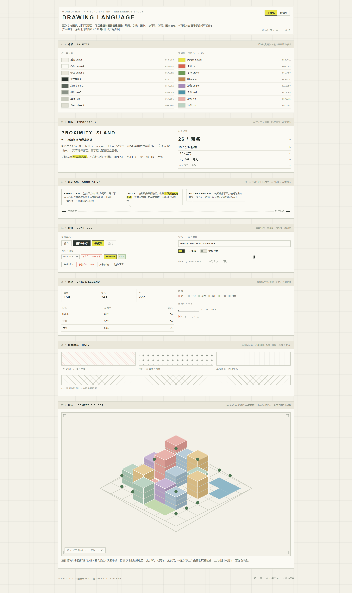

*`docs/styleboard.html` 全页：色板、注记、数据图例、图案填充与纯 SVG 等距城市图面。*

> **衔接提示**：「功能和表达都定稿了。最后一步很朴素：把这套东西交出去，但用户已经有一个同名的旧仓库——所以是新建，不是覆盖。」

---

## 阶段五 · 交付：新建仓库，保留旧库

**一句话定位**：把当前项目完整开源到一个新仓库，且完全不触碰已有的 `chovy7519/worldcraft`。

### 需求与处理

- 确认账号 `chovy7519` 下已有 `worldcraft` 仓库（公开、`main` 分支），新仓库名由用户指定为 `worldcraft-hy4`，由用户在 GitHub 网页手工创建为空仓库。
- **授权路径**：GitHub 连接器虽已绑定但状态不可用，重连被取消；本机无 `gh` CLI、无环境变量令牌、凭据管理器无 GitHub 条目。最终未使用任何 PAT 或令牌——用户建好空仓库后直接 `git push`，系统凭据管理器已具备写权限。
- **网络问题**：本机代理环境下 Git 默认 `schannel` 对 github.com 握手失败（而 `curl` 访问 `api.github.com` 正常），在仓库级设置 `http.sslBackend=openssl` 后连通。
- **并行改动处理**：上传期间视觉体系改造仍在产生文件，每批都先跑 `tsc --noEmit`、`vite build`、`vitest` 再做增量提交，避免推送半成品。
- **一个需要讲清的客观事实**：Git 仓库是在本阶段才初始化的，所以前四个阶段的代码集中在首个提交 `97e5ee4`（55 文件 / 12161 行），随后三个提交分别对应视觉规范文档、样式重写、组件与风格板迭代；不能读作「每个阶段各有独立提交」。
- 原有 `worldcraft` 仓库全程只做只读查询，未向其推送；其 HEAD 在会话期间由其他会话从 `a61a2c5` 更新到 `9cceec1`（V0.6），与本次上传无关。

### 已有验证结论

- 远端 HEAD `4af71c0` 与本地一致；4 个提交、57 个 blob、`truncated=false`；docs 10 / src 40；`node_modules/`（256 M）与 `dist/` 未上传。
- 敏感信息扫描：无 token、`.env`、凭据文件入库；`.github_pat` 从未创建。

### 视频可取的演示点

- GitHub 上两个仓库并存的列表画面：旧的 `worldcraft` 与新的 `worldcraft-hy4`，说明「新建而非替换」。
- 提交历史四个条目，对应「核心 → 规范 → 样式 → 组件迭代」，顺带说明「Git 是最后才建的」这个真实情况。
- 文件树里 `src/core/geom/`、`src/core/pipeline/`、`docs/` 的目录结构，作为全片收尾的全景。

### 配图

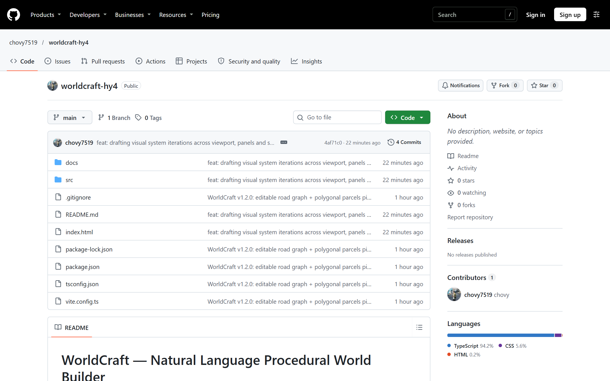

*公开仓库、`main` 分支、4 个提交、文件列表与 README；右侧显示语言构成。注意：补拍的 `story-*` 截图与本文尚未推送，远端仍是当时的 57 文件状态。*

> **衔接提示**（收尾）：「回看整条线：一个『其他区域不变』的要求，逼出了坐标哈希；为了让规则可追溯，拆出了阶段 DAG；为了让形状可编辑，重构成了平面图系统；最后换了一层表达语言，而指纹始终没变。」

---

## 6. 最终成果（汇总）

| 维度 | 成果 |
| --- | --- |
| 产品形态 | 浏览器内三维城市编辑器；Hierarchy / Viewport / PCG Inspector / AI Command 四大面板，另有「图形编辑」面板、6 个 Inspector 标签与 4 种相机预设 |
| 生成引擎 | 7 层阶段 DAG + 可编辑道路图 + 多边形（含凹凸）地块 + 五类建筑原型 / 三档公园 / 分级道路 / 净距驱动树木；E1 水系、E2 地形为已声明契约的扩展点 |
| 数据与命令 | Scene Schema v1.2.0（v1.0 / v1.1 自动迁移）、封闭 `Command` 联合类型与白名单校验、64 项规则字段注册表、文档快照式撤销重做、localStorage 与 JSON 导入导出 |
| 一致性保障 | 确定性指纹、规则变化时间线、逐对象 `trace`、14 类空间冲突校验、面积守恒、12 文件 / 93 用例 |
| 视觉 | 图纸 / 海图双主题制图语言，`docs/styleboard.html` 组件级风格板；视觉改造前后默认场景指纹一致 |
| 文档 | `README.md` + `docs/` 七份 md（六份规范 + 本文）+ `styleboard.html` + 18 张不重复截图（10 张历史存档、8 张整理时补拍） |
| 开源 | `https://github.com/chovy7519/worldcraft-hy4`，4 提交 / 57 文件；原 `chovy7519/worldcraft` 保留 |

> 开源统计为 2026-11-06 推送完成时的远端状态；之后复原归档的历史截图、补拍的截图与本文尚未推送。`screenshots/` 内另有一份 `demo-topview.png` 是 `demo-editable-top.png` 的副本，不计入 18 张。

**明确写进文档的边界（不掩饰）**：本地 NL 解析器是规则式，只覆盖已注册句式；建筑轮廓为旋转内接矩形族，不是任意多边形挤出；部分顶点编辑会被主动拒绝；连续两次 `parcel.merge` 可能被跳过并记入 `skippedEdits`；E1 / E2 只生成占位几何；树冠半径未参与净距；LLM 为浏览器直连，密钥只存 localStorage，生产前需后端代理；自由节点图编辑、Blender Geometry Nodes、Unreal PCG 均未实现；视觉阶段当时未做浏览器截图验证，现有界面截图为后续补拍。

---

## 7. 视频重点演示亮点清单

### 主线必演（建议按此顺序，构成完整叙事）

| # | 亮点 | 所属阶段 | 画面 / 看点 | 可引用的硬数据 |
| --- | --- | --- | --- | --- |
| 1 | 「其他区域不变」为什么是个架构问题 | 一 | 全局随机流与坐标哈希的对比示意，配分区图 | 东侧 52% vs 其他分区 65–70% 逐位不变 |
| 2 | 一键验收演示 + 指纹变化 | 一 / 三 | 六步流程自动跑完，HUD 指纹随之改变 | `18D5742B → 42A85A40`（V0.1）；`381A0250 → BE29C1BA`（v1.2） |
| 3 | 规则变化时间线 | 一 | 撤销 / 加载之后仍能看到逐字段 diff | `density.zoneMultipliers.east 1 → 0.7` |
| 4 | 阶段 DAG 与空间校验面板 | 二 | 7 层依赖、各阶段产出、E1/E2「预留」、校验明细 | 14 组参数组合全 PASS；最小株距 3.52 m |
| 5 | 图形编辑三连 + 凹形地块 | 三 | 斜向路 → 斜切 → L 形凹地块，每步 HUD 数字与 PASS 同框 | 241 → 243 → 255 地块；凹形 0 → 1；四步指纹全不同 |
| 6 | 双主题切换与指纹不变 | 四 | 图纸 / 海图切换，同一场景同一指纹 | 改造前后均为 `381A0250` |

### 加分可选（按时间取舍）

| # | 亮点 | 所属阶段 | 讲述角度 |
| --- | --- | --- | --- |
| 7 | 顶视「地块/功能」视图 | 二 / 三 | 路网、地块红线、功能着色、多尺寸公园与中央大公园同框，一图看完整链路 |
| 8 | 节点手柄拖拽与下游重适配 | 三 | 拖动道路节点后建筑、公园、树一起改，强调「不是重新生成整城」 |
| 9 | 被主动拒绝的编辑 | 三 | 讲一致性策略：路段上的孤立顶点移动会被拒绝，避免建筑压占道路带 |
| 10 | 参数敏感性演示 | 二 | 改 `parkRatio` 后建筑 / 公园 / 树同时变化、空间校验仍 PASS，说明参数确实接在阶段上 |
| 11 | 测试规模随架构演进 | 一 → 三 | 39 → 77 → 93 用例，`spatial.test.ts` 24 例与 14 组参数组合，说明复杂度上来后靠什么兜底 |
| 12 | 两个仓库并存 | 五 | 新建而非替换的交付结果；顺带说明 Git 是最后才初始化的 |

### 配图速查（按讲述顺序直接取图）

| 顺序 | 画面 | 文件（`docs/screenshots/` 下） | 性质 |
| --- | --- | --- | --- |
| 开场 | 当前工作台全貌 | `story-01-workbench-sheet.png` | 当前实拍 |
| 阶段一 | V0.1 初始 1096 栋 / `18D5742B` | `history-v01-initial.png` | **历史存档** |
| 阶段一 | V0.1 演示后 1021 栋 / `42A85A40` | `history-v01-after-demo.png` | **历史存档** |
| 阶段一 | V0.1 顶视中央公园 | `history-v01-topview.png` | **历史存档** |
| 阶段一 | 同一验收链路的当前版本画面 | `story-02-acceptance-diff.png` | 当前复现（可选） |
| 阶段二 | v1.1.0 7 层 DAG / `A74CBFE6` | `history-v11-pipeline-dag.png` | **历史存档** |
| 阶段二 | v1.1.0 顶视地块 / 功能 | `history-v11-parcel-top.png` | **历史存档** |
| 阶段二 | v1.1.0 参数调整 / `5E4CEAB5` | `history-v11-parameter.png` | **历史存档** |
| 阶段二 | 命令面板布局修复前后 | `history-v11-cmd-panel.png`、`history-v11-cmd-detail.png` | **历史存档**（可选） |
| 阶段二 | 同一场景的当前版本画面 | `story-03-pipeline-dag.png`、`story-04-parcel-top.png` | 当前复现（可选） |
| 阶段三 | v1.2.0 图形编辑终态（深色） | `demo-editable-top.png` | **历史存档** |
| 阶段三 | 当前版本同一组编辑终态 | `story-05-editable-concave.png` | 当前实拍 |
| 阶段四 | 图纸 / 海图对照 | `story-01-workbench-sheet.png`、`story-06-nautical.png` | 当前实拍（该阶段无历史截图） |
| 阶段四 | 风格板全页 | `story-07-styleboard.png` | 当前实拍 |
| 阶段五 | GitHub 仓库首页 | `story-08-github.png` | 实拍 |

### 推荐讲述顺序

**开场一页**（目标 + 验收场景那把尺子）→ **阶段一**（架构判断 + 验收演示）→ **阶段二**（流程可视化 + 参数敏感性）→ **阶段三**（编辑三连，全片视觉高潮）→ **阶段四**（主题切换 + 指纹不变，收在「没破坏什么」）→ **阶段五**（仓库与文档全景）→ **收尾**（把「确定性 → 可追溯 → 可编辑 → 可表达」串成一条线，并主动说两个已知限制）。

> 录制时建议保留的原始材料：本文、`docs/` 六份规范、`docs/styleboard.html`、`docs/screenshots/` 全部 18 张不重复截图（按上文区分 V0.1 / v1.1.0 / v1.2.0 历史存档与当前实拍）、`docs/ACCEPTANCE.md` 与 `docs/EDITABLE_GEOMETRY.md` 中的实测表格、GitHub 提交历史。V0.1 与 v1.1.0 的历史截图来自用户从回收站复原的原文件，已复制归档、原文件未改动。所有引用数字都能在这些文件里找到出处。
